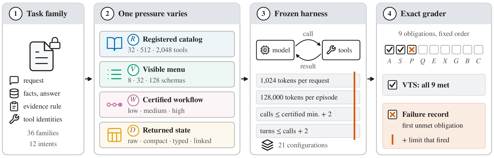

# ToolBottleneckBench

[](https://arxiv.org/abs/2610.21098)
[](LICENSE)


Code and data for the paper
**[ToolBottleneckBench: Measuring Tool-Agent Performance under Controlled Pressures and Fixed Harness Budgets](https://arxiv.org/abs/2610.21098)**.

Zichuan Xu, Yuyang Dong, Makoto Onizuka, Chuan Xiao



## Overview

A tool agent's success score reflects both its model and the budgets of the
harness that runs it. ToolBottleneckBench keeps synthetic enterprise tasks fixed
while one pressure varies: the registered tool catalog, the visible tool menu,
the certified workflow, or the encoding of returned records. All main results
share one frozen set of harness budgets, and an exact grader records the first
unmet obligation of each failed episode and the harness limit, if any, that
ended it.

Across 21 model and harness configurations, the visible menu is the only
model-facing pressure with a large penalty, and this penalty tracks truncation
at the completion cap; raising the cap sixteenfold removes most of it in the
truncation-heavy configurations. Most failures end at a harness limit, and only
two repairs, neither improving model behavior, beat every configuration switch
on success. See the [paper](https://arxiv.org/abs/2610.21098) for details.

## Installation

Python 3.11 or 3.12 is required.

```bash
git clone https://github.com/zichuanxu/tool-bottleneck-bench.git
cd tool-bottleneck-bench
python3.11 -m venv .venv
source .venv/bin/activate
python -m pip install --require-hashes -r requirements.lock
python -m pip install -e . --no-deps
```

## Usage

Build the task suite and check its construct invariants (offline):

```bash
bottleneckbench audit --output-dir audit-reports
```

Run the release check and the test suite:

```bash
make verify
```

Re-run the completion-cap sweep analysis from the released rows:

```bash
PYTHONPATH=src .venv/bin/python experiments/analyze_cap_sweep_campaign.py \
  --output cap-sweep-recheck.json
```

## Data

The scored rows and analyses behind the paper are in
`results/reporting-panel-2026-10-13-final21/`, and
`results/reporting-panel-2026-10-13-final21-verification-v1/report.json`
records a deterministic recomputation of the released analyses. The
completion-cap sweep is in `results/prospective-execution/completion-cap-sweep-1/`
and `results/prospective-execution/completion-cap-sweep-2/`. The
[benchmark card](docs/benchmark-card.md) and the
[claim–artifact map](docs/claim-artifact-map.md) link each finding to its rows
and analyses. Raw provider receipts and the acquisition runners, which need
provider credentials, are not included; every command above runs offline.

## Repository structure

```text
configs/       frozen price metadata used by the offline analyses
docs/          benchmark card, claim–artifact map and system card
experiments/   release analyses and offline replay utilities
protocols/     dated study protocols
results/       scored rows, frozen plans and analysis outputs
scripts/       public release check
src/           task compiler, sandbox, exact grader and agent loop
tests/         test suite
vendor/        pinned ToolSandbox subset
```

## Citation

```bibtex
@misc{xu2026toolbottleneckbench,
  title         = {{ToolBottleneckBench}: Measuring Tool-Agent Performance under Controlled Pressures and Fixed Harness Budgets},
  author        = {Xu, Zichuan and Dong, Yuyang and Onizuka, Makoto and Xiao, Chuan},
  year          = {2026},
  eprint        = {2610.21098},
  archivePrefix = {arXiv},
  primaryClass  = {cs.CL},
  url           = {https://arxiv.org/abs/2610.21098}
}
```

## License

This repository is released under the [MIT License](LICENSE). The vendored
ToolSandbox subset and the model-generated text in scored records keep their
upstream terms; see [THIRD_PARTY_NOTICES.md](THIRD_PARTY_NOTICES.md).

## Acknowledgments

This work was supported by JST CREST Grant Number JPMJCR22M2 and JSPS KAKENHI
Grant Numbers JP23K17456, JP23K28096, JP25H01117, JP25K21207, and JP26K03246.
